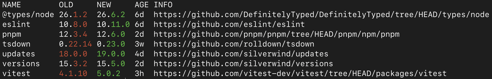

# updates
[](https://www.npmjs.org/package/updates) [](https://www.npmjs.org/package/updates) [](https://packagephobia.com/result?p=updates) [](https://depx.co/pkg/updates)



`updates` is a CLI tool that checks for dependency updates, with zero dependencies.

## Supported files

- `package.json`, `pnpm-workspace.yaml` - npm dependencies
- `pyproject.toml` - python dependencies
- `go.mod`, `go.work` - go dependencies
- `Cargo.toml` - rust dependencies
- `.{github,gitea,forgejo}/{workflows,actions}`, `action.{yml,yaml}` - actions and docker images
- `{Docker,Container}file*`, `*.{Docker,Container}file`, `compose*.{yml,yaml}`, `docker-*.{yml,yaml}` - docker images
- `Makefile`, `*.mk`, `*.sh` - `go install` versions and docker images in `*_IMAGE` variables
- `renovate:` and `updates:` comments - marked versions, see [Annotations](#annotations)

## Usage

```sh
# check for updates
pnpm dlx updates

# update package.json and install new dependencies
pnpm dlx updates -u && pnpm i
```

## Options

|Option|Description|
|:-|:-|
|`-u, --update`|Update versions and write dependency file|
|`-f, --file <path,...>`|File or directory to use, defaults to current directory|
|`-N, --include-paths <glob,...>`|Only use paths matching the globs|
|`-X, --exclude-paths <glob,...>`|Skip paths matching the globs|
|`-M, --modes <mode,...>`|Modes to enable: `npm`, `pypi`, `go`, `cargo`, `actions`, `docker`. Default: all|
|`-i, --include <dep,...>`|Include only given dependencies|
|`-e, --exclude <dep,...>`|Exclude given dependencies|
|`-l, --pin <dep=range>`|Pin dependency to given semver range|
|`-C, --cooldown <duration>`|Minimum dependency age, like `12h`, `7d` or `2w`. A bare number is days|
|`-p, --prerelease [<dep,...>]`|Consider prereleases, implying `--greatest`|
|`-R, --release [<dep,...>]`|Never consider prereleases|
|`-g, --greatest [<dep,...>]`|Ignore the `latest` tag and take the greatest release|
|`-t, --types <type,...>`|Dependency types to update|
|`-P, --patch [<dep,...>]`|Consider only up to semver-patch|
|`-m, --minor [<dep,...>]`|Consider only up to semver-minor|
|`-d, --allow-downgrade [<dep,...>]`|Allow downgrading onto a lower `latest` tag|
|`-s, --sockets <num>`|Maximum number of parallel HTTP sockets opened. Default: 50|
|`-T, --timeout <ms>`|Network request timeout in ms. Default: 5000|
|`-r, --registry <url>`|Override npm registry URL|
|`-L, --login <host>`|Verify and store a forge API token|
|`-O, --logout <host>`|Remove a stored forge API token|
|`-I, --indirect`|Include indirect Go dependencies|
|`-E, --error-on-outdated`|Exit with code 2 when updates are available and 0 when not|
|`-U, --error-on-unchanged`|Exit with code 0 when updates are available and 2 when not|
|`-j, --json`|Output a JSON object|
|`-x, --no-cache`|Disable HTTP cache|
|`-c, --color`|Force color output|
|`-n, --no-color`|Disable color output|
|`-v, --version`|Print the version|
|`-V, --verbose`|Print verbose output to stderr|
|`-h, --help`|Print the help|

Lists are comma-separated or repeated. `dep` takes globs like `foo*` or regexes like `'/^foo/'`, except in `--pin`. Failed lookups are reported separately and exit with code 1.

## Annotations

Versions marked by a [Renovate](https://docs.renovatebot.com/modules/manager/regex/)-style `renovate:` or `updates:` comment are updated in workflow, docker, make and shell files, and in other files passed via `--file`. The comment goes after the version or on the line above it:

```sh
RENOVATE_VERSION=44.172.2 # renovate: datasource=npm depName=renovate
# updates: datasource=github-releases depName=mvdan/gofumpt
GOFUMPT_VERSION=v0.12.0
```

Supported datasources are `npm`, `pypi`, `crate`, `go`, `docker` and `{github,gitea,forgejo}-{tags,releases}`. Fields are `depName`, `packageName`, `lookupName` and `versioning`, plus `extractVersion` and `registryUrl` for forges. On lines with several versions, attach the version to its package name, like `black@24.1.0` or `black==24.1.0`.

Annotations belong to their datasource's mode, with `crate` under `cargo` and forges under `actions`. `--verbose` shows why an annotation is skipped.

## Config File

Configure via `updates.config.{js,ts,mjs,mts}`. Each manifest uses the nearest config above it, and CLI arguments take precedence.

```ts
import type {Config} from "updates";

export default {
  pin: {
    "typescript": "^6",
  },
} satisfies Config;
```

### Config Options

Mirrors the [CLI options](#options) in camelCase, with `--file` as `files`, plus:

- `overrides` *Array\<Override>*: Per-package option overrides (see [Overrides](#overrides))
- `inherit` *object*: Fields to inherit from other tools' configs (see [Renovate config](#renovate-config))
- `filePatterns` *object*: Extra files for the `actions` mode as globs or RegExps, e.g. `{actions: [/\.ya?ml\.tmpl$/]}`

### Overrides

Each override applies any of `cooldown`, `greatest`, `prerelease`, `release`, `patch`, `minor` and `allowDowngrade` to the dependencies matching its `include` and `exclude` patterns, or to all when `include` is omitted. Overrides beat top-level options and the last match wins.

```ts
import type {Config} from "updates";

export default {
  cooldown: "7d",
  overrides: [
    {include: ["@myorg/*"], cooldown: 0},      // no cooldown for your own scope
    {include: [/^@aws-sdk/], cooldown: "14d"}, // longer cooldown for a noisy publisher
    {exclude: ["typescript"], greatest: true}, // greatest for everything but typescript
  ],
} satisfies Config;
```

### Renovate config

A [Renovate](https://docs.renovatebot.com/) `renovate.json`, `renovate.jsonc` or `renovate.json5` is picked up automatically. Its `ignoreDeps`, the `enabled` and `allowedVersions` of its `packageRules` and its `github-actions` file patterns are inherited. Presets in `extends` are not resolved. `minimumReleaseAge` is only inherited when opted in:

```ts
export default {
  inherit: {
    renovate: {cooldown: true},
  },
} satisfies Config;
```

Values in `updates.config` override anything inherited.

## API

`updates` can be used as a library and accepts all [config options](#config-options):

```ts
import {updates} from "updates";

const output = await updates({
  files: ["package.json"],
  include: [/^react/],
  modes: ["npm"],
});
//=> {
//=>   "results": {
//=>     "npm": {
//=>       "dependencies": {
//=>         "react": {
//=>           "old": "18.0.0",
//=>           "new": "19.2.0",
//=>           "info": "https://github.com/facebook/react",
//=>           "age": "2d"
//=>         }
//=>       }
//=>     }
//=>   }
//=> }
```

## Environment Variables

|Variable|Description|
|:-|:-|
|`UPDATES_FORGE_TOKENS`|Comma-separated `host:token` pairs for forge APIs, e.g. `github.com:ghp_xxx,localhost:3500:tok_xxx`|
|`UPDATES_GITHUB_API_TOKEN`|GitHub API token. Falls back to `GITHUB_API_TOKEN`, `GH_TOKEN`, `GITHUB_TOKEN` and `HOMEBREW_GITHUB_API_TOKEN`|
|`UPDATES_GITEA_API_TOKEN`|Gitea or Forgejo API token for `GITEA_URL`. Falls back to `GITEA_API_TOKEN`, `GITEA_AUTH_TOKEN`, `GITEA_TOKEN` and `FORGEJO_TOKEN`|
|`GITEA_URL`|URL of the Gitea or Forgejo instance the Gitea token belongs to, e.g. `https://gitea.example.com`|
|`GITEA_SERVER_URL`|URL of the Gitea instance for `self:owner/repo@ref` actions. Falls back to `GITHUB_SERVER_URL` and the `origin` remote|
|`pnpm_config__auth`|npm registry credentials in [pnpm's format](https://pnpm.io/npmrc#_auth), e.g. `{"https://registry.npmjs.org":{"@":{"authToken":"npm-token"}}}`|
|`GOPROXY`, `GONOPROXY`, `GOPRIVATE`|Go module proxy settings, honored as go does|

Tokens in `UPDATES_FORGE_TOKENS` win over ones stored with `--login`, which win over the other token variables. npm registries and credentials resolve like pnpm does, including `pnpm-workspace.yaml`, pnpm's global `config.yaml` and `.npmrc`.

© [silverwind](https://github.com/silverwind), distributed under BSD licence
